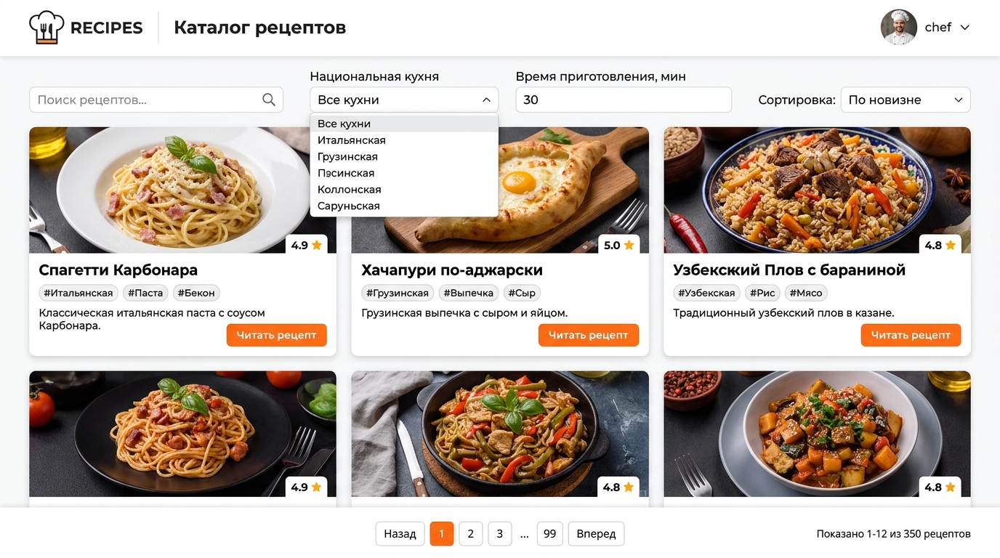
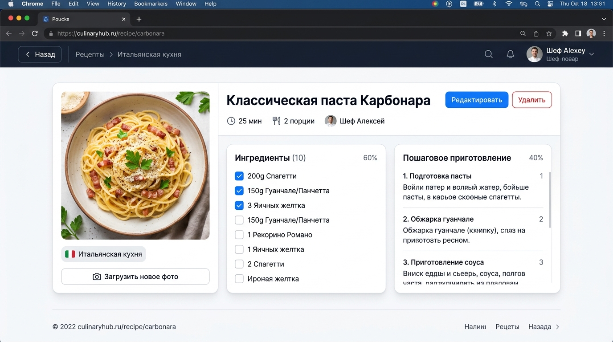
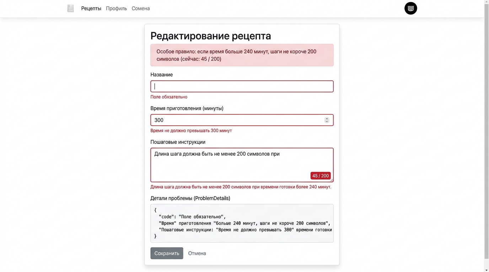
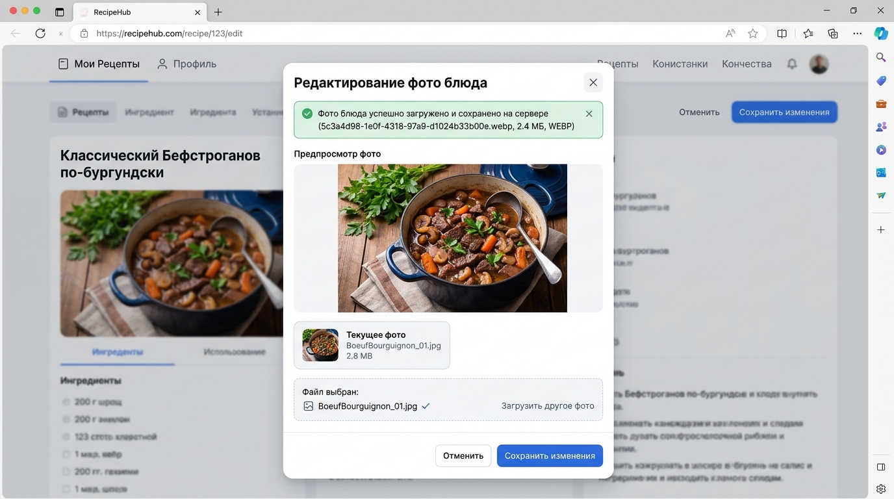

# Проект: «Рецепты» (Кулинарная книга)

**Тема:** Каталог рецептов и национальных кухонь мира  
**Стек технологий:** ASP.NET Core Web API (.NET 10, Minimal API) + Entity Framework Core (SQLite) + FluentValidation + JWT + Angular (Signals, Standalone)

---

## 📌 Оглавление
1. [Соответствие всем требованиям](#-соответствие-требованиям)
2. [Тестовые учетные записи](#-тестовые-учетные-записи)
3. [Быстрый запуск](#-быстрый-запуск)
4. [Скриншоты приложения](#-скриншоты-приложения)
5. [Эндпоинты API и файл .http](#-эндпоинты-api)
6. [Шпаргалка к защите (Объяснение строк кода)](#-шпаргалка-к-защите)

---

## 📋 Соответствие требованиям

### 1. Сервер — ASP.NET Core Web API (.NET 10)
* **Платформа:** `.NET 10.0` (Minimal API, группа адресов `/api/recipes`).
* **5 CRUD endpoint'ов:**
  * `GET /api/recipes` — список с пагинацией (`page`, `pageSize`, `total`), фильтрами и сортировкой.
  * `GET /api/recipes/{id}` — получение рецепта по ID.
  * `POST /api/recipes` — создание нового рецепта (только авторизованный пользователь, `201 Created`).
  * `PUT /api/recipes/{id}` — редактирование рецепта (только автор записи, `200 OK` / `204 NoContent`).
  * `DELETE /api/recipes/{id}` — удаление рецепта (только автор записи, `204 NoContent`).
* **DTO через `record`:** Сущности базы данных наружу не отдаются; используются DTO-записи (`RecipeDto`, `RecipeCreateDto`, `RecipeUpdateDto`, `PagedResult<T>`, `AuthResponseDto`, `CuisineDto`).
* **Правильные HTTP-коды ответов:** `200 OK`, `201 Created`, `204 NoContent`, `400 BadRequest`, `401 Unauthorized`, `403 Forbidden`, `404 NotFound`.
* **Документация:** Swagger UI открывается по адресу `http://localhost:5000/swagger` с поддержкой JWT Bearer авторизации.

### 2. База данных — EF Core + SQLite
* **Связь «один-ко-многим»:** Таблица `Recipes` связана со справочником `Cuisines` (национальные кухни) и пользователями `Users`.
* **2 миграции в папке `Migrations/`:**
  1. `InitialCreate` — базовая схема таблиц.
  2. `AddUserAuthAndSeedData` — модель пользователей, связь с автором и сидинг.
* **Начальные данные через `HasData`:** Справочник 7 кухонь мира, тестовые пользователи и 7 детальных рецептов блюд.
* **База данных не загружается в git:** Файлы `*.db`, `*.db-shm`, `*.db-wal` прописаны в `.gitignore`.

### 3. Валидация
* **FluentValidation на сервере:** Валидаторы `RecipeCreateDtoValidator`, `RecipeUpdateDtoValidator`, `RegisterDtoValidator`, `LoginDtoValidator`.
* **Формат ProblemDetails:** Ошибки валидации возвращаются как HTTP 400 со стандартным объектом `errors` (`{ "Title": [...], "Steps": [...] }`).
* **Особое бизнес-правило:**
  > **«Если время больше 240 минут, шаги не короче 200 символов.»**
  Реализовано в FluentValidation (`When(x => x.CookingTimeMinutes > 240, ...)`) и на клиенте с динамическим счетчиком символов.
* **Ошибки на клиенте:** Серверные и клиентские ошибки отображаются прямо под соответствующим полем формы.

### 4. Вход и права (Аутентификация & Авторизация)
* **Хеширование паролей:** Пароли пользователей никогда не хранятся в открытом виде; используется криптостойкий алгоритм PBKDF2 (SHA-256, 100 000 итераций) с уникальной солью.
* **JWT-токены:** Ключ подписи хранится в безопасном хранилище `user-secrets` (`dotnet user-secrets set "Jwt:Key" ...`), исключен из кода и git.
* **Разграничение доступа:**
  * Просмотр каталога и рецепта — открыт для всех.
  * Создание рецепта — только для вошедших пользователей (иначе `401 Unauthorized`).
  * Редактирование и удаление — строго только автор записи (иначе `403 Forbidden`).

### 5. Страницы, сортировка, работа с файлами
* **Пагинация:** Параметры `page`, `pageSize`, `total`, вычисление `totalPages`, кнопки «Назад» и «Вперёд».
* **Фильтры:** По национальной кухне, по времени приготовления (до N минут), поиск по ключевым словам.
* **2 вида сортировки:** По дате добавления (новые) и по времени приготовления (возрастание / убывание).
* **Загрузка файла:** Эндпоинт `POST /api/recipes/{id}/image`:
  * Доступен только автору рецепта (иначе `403 Forbidden`).
  * Ограничение по размеру: строго до 5 МБ.
  * Разрешенные форматы: только `.jpg`, `.jpeg`, `.png`, `.webp`.
  * Имя файла на сервере — уникальный `Guid` (`fileName = $"{Guid.NewGuid():D}{ext}"`).

### 6. Клиент — Angular (Signals & Modern Architecture)
* **Компоненты:**
  * `RecipeCardComponent` — карточка рецепта (использует современные `input()`, `output()`).
  * `RecipeFilterComponent` — панель фильтрации (использует `input()`, `output()`).
  * `RecipeListComponent` — каталог рецептов, пагинация, управление.
  * `RecipeDetailComponent` — детальная страница, чек-лист ингредиентов, загрузка фото.
  * `RecipeFormComponent` — создание и редактирование с отображением серверных ProblemDetails.
  * `LoginComponent` & `RegisterComponent` — авторизация и регистрация.
  * `NotFoundComponent` — страница 404.
* **Сервисы:** Использование `inject(HttpClient)`.
* **4 состояния каждого экрана:**
  1. `loading` — спиннер загрузки.
  2. `error` — блок ошибки с кнопкой повтора запроса.
  3. `empty` — плашка «Рецепты не найдены» со сбросом фильтров.
  4. `data` — отображение актуальных данных.
* **Интерсептор и Guard:**
  * `authInterceptor` автоматически добавляет заголовок `Authorization: Bearer <token>`.
  * `authGuard` защищает маршруты `/recipes/new` и `/recipes/:id/edit`.
* **Кнопки автора:** Кнопки «Редактировать», «Удалить» и «Загрузить фото» отображаются **только автору** рецепта.

---

## 🔑 Тестовые учетные записи

| Пользователь | Логин | Пароль | Роль / Авторство |
| :--- | :--- | :--- | :--- |
| **Шеф-автор** | `chef` | `Chef123!` | Автор 5 рецептов (Карбонара, Хачапури, Плов, Тако, Беф Бургиньон) |
| **Второй повар** | `testuser` | `User123!` | Автор рецептов Лукового супа и Том Яма (для проверки ошибки 403) |

---

## 🚀 Быстрый запуск

### Способ 1. Запуск одним кликом
Запустите файл **`run-all.bat`** из корня проекта. Он откроет бэкенд и фронтенд в двух окнах терминала.

### Способ 2. Запуск вручную

#### 1. Запуск Backend API (.NET 10):
```bash
cd RecipesApi
dotnet run
```
* **API и Swagger:** `http://localhost:5000/swagger`

#### 2. Запуск Frontend (Angular):
```bash
cd recipes-client
npm start
```
* **Приложение в браузере:** `http://localhost:4200`

---

## 📸 Скриншоты приложения

### 1. Каталог рецептов (Список со страницами и фильтрами)
Фильтры по кухне, времени и поиску, карточки блюд, кнопки пагинации «Назад» / «Вперёд»:


---

### 2. Страница одного рецепта
Детальная страница с фото, чек-листом ингредиентов, шагами и кнопками автора («Редактировать», «Удалить», «Загрузить новое фото»):


---

### 3. Форма с ошибками валидации (ProblemDetails и особое правило)
Ошибки сервера отображаются прямо под полями; проверка особого правила при времени > 240 минут:


---

### 4. Загрузка фото блюда автором
Загрузка файла до 5 МБ (JPG/PNG/WEBP), сохранение с GUID-именем на сервере и обновление фото:


---

## 📡 Эндпоинты API

Файл **`RecipesApi/RecipesApi.http`** содержит готовые запросы ко всем эндпоинтам:

| Метод | URL | Описание | Код ответа |
| :--- | :--- | :--- | :--- |
| `POST` | `/api/auth/register` | Регистрация нового пользователя | `201 Created` |
| `POST` | `/api/auth/login` | Вход и получение JWT токена | `200 OK` |
| `GET` | `/api/auth/me` | Данные текущего пользователя | `200 OK` / `401` |
| `GET` | `/api/cuisines` | Справочник кухонь мира | `200 OK` |
| `GET` | `/api/recipes` | Список рецептов с фильтрацией и пагинацией | `200 OK` |
| `GET` | `/api/recipes/{id}` | Получение рецепта по ID | `200 OK` / `404` |
| `POST` | `/api/recipes` | Создание рецепта (требуется вход) | `201 Created` / `401` / `400` |
| `PUT` | `/api/recipes/{id}` | Изменение рецепта (только автор) | `200 OK` / `403` / `404` |
| `DELETE` | `/api/recipes/{id}` | Удаление рецепта (только автор) | `204 NoContent` / `403` / `404` |
| `POST` | `/api/recipes/{id}/image` | Загрузка фото до 5 МБ (только автор) | `200 OK` / `400` / `403` |

---

## 🎓 Шпаргалка к защите

### 1. Как работает проверка особого правила на сервере?
```csharp
// RecipesApi/Validators/RecipeValidators.cs
When(x => x.CookingTimeMinutes > 240, () =>
{
    RuleFor(x => x.Steps)
        .MinimumLength(200)
        .WithMessage("Особое правило: если время больше 240 минут, шаги не короче 200 символов.");
});
```
* **Объяснение:** `When(...)` из FluentValidation активирует валидатор минимальной длины строки шагов (200 символов) только в том случае, если время приготовления блюда строго превышает 240 минут. При нарушении формируется `ProblemDetails` с HTTP-кодом `400 Bad Request`.

### 2. Как проверяется авторство и возвращается отказ 403 Forbidden?
```csharp
// RecipesApi/Endpoints/RecipeEndpoints.cs
var userIdStr = user.FindFirst(ClaimTypes.NameIdentifier)?.Value;
if (recipe.AuthorId != currentUserId)
{
    return Results.StatusCode(StatusCodes.Status403Forbidden);
}
```
* **Объяснение:** Сервер извлекает идентификатор вошедшего пользователя из клеймов проверенного JWT-токена (`ClaimTypes.NameIdentifier`) и сравнивает его с внешним ключом `AuthorId` сущности рецепта в базе данных. Если идентификаторы не совпадают, выполнение прерывается с кодом `403 Forbidden`.

### 3. Как Angular передает токен и управляет состояниями?
```typescript
// recipes-client/src/app/interceptors/auth.interceptor.ts
export const authInterceptor: HttpInterceptorFn = (req, next) => {
  const authService = inject(AuthService);
  const token = authService.getToken();
  if (token && req.url.startsWith('http://localhost:5000')) {
    return next(req.clone({ setHeaders: { Authorization: `Bearer ${token}` } }));
  }
  return next(req);
};
```
* **Объяснение:** Функциональный `HttpInterceptorFn` перехватывает исходящие HTTP-запросы к бэкенду и, если пользователь авторизован, клонирует запрос с заголовком `Authorization: Bearer <JWT>`.
